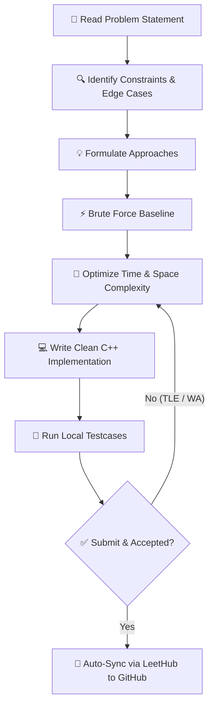
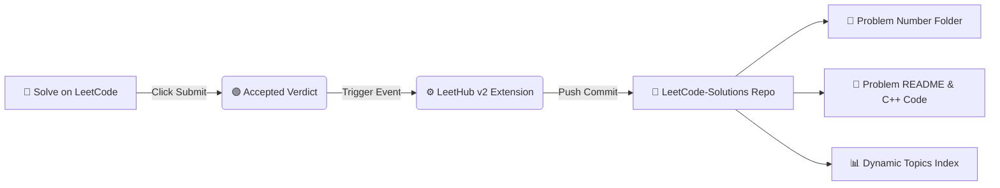

<p align="center">
  <h1 align="center">⚡ LeetCode Solutions & DSA Archive</h1>
  <p align="center">
    <strong>A structured repository of daily LeetCode solutions written in modern C++, focused on optimal time & space complexity, pattern recognition, and technical interview preparation.</strong>
  </p>
</p>

<p align="center">
  <a href="https://leetcode.com/u/DGOsPiIh5O/"></a>
  <a href="https://github.com/muskanji1007-lang"></a>
  
  
</p>

---

## 📊 Live LeetCode Performance

<p align="center">
  <a href="https://leetcode.com/u/DGOsPiIh5O/">
    
  </a>
</p>

---

## 🎯 About This Repository

This repository tracks my journey of solving Data Structures and Algorithms problems daily. Each problem folder contains:
- 📄 **`README.md`**: Problem statement, constraints, example test cases, and difficulty level.
- 💻 **`Solution.cpp`**: Clean, readable, and optimized C++ implementation.

### 🌟 Core Objectives
- 💡 **Pattern Recognition:** Grouping problems by algorithmic paradigms (Two Pointers, Hash Table, Sliding Window, Prefix Sum).
- ⚡ **Optimization:** Moving from Brute-Force $O(N^2)$ to Optimal $O(N)$ / $O(N \log N)$ approaches.
- 📈 **Daily Consistency:** Maintaining an unbroken streak on LeetCode and GitHub.

---

## 🔄 Problem-Solving Workflow



---

## ⚙️ Automated CI/CD Sync Pipeline



---

## 🗂️ Repository Structure

```text
LeetCode-Solutions/
│
├── 0001-two-sum/
│   ├── 0001-two-sum.cpp
│   └── README.md
│
├── 0007-reverse-integer/
├── 0009-palindrome-number/
├── 0013-roman-to-integer/
├── 0026-remove-duplicates-from-sorted-array/
├── 0217-contains-duplicate/
├── 0283-move-zeroes/
├── 1295-find-numbers-with-even-number-of-digits/
├── 1480-running-sum-of-1d-array/
├── 1486-xor-operation-in-an-array/
├── 1672-richest-customer-wealth/
├── 1929-concatenation-of-array/
├── stats.json
└── README.md
```

---

## 🛠️ Tech Stack & Topics

<details>
<summary><strong>🔍 Click to expand Algorithmic Topics Covered</strong></summary>
<br>

| Category | Primary Focus Areas |
| :--- | :--- |
| **Data Structures** | Arrays, Vectors, Hash Tables, Unordered Maps, Strings, Matrices |
| **Algorithmic Patterns** | Two Pointers, Prefix Sum, Bitwise Operations, Sorting, Simulation |
| **Language & Standard** | C++20 (STL: `<vector>`, `<unordered_map>`, `<algorithm>`, `<numeric>`) |
| **Complexity Focus** | Time Complexity minimization & Auxiliary Space optimization |

</details>

---

<!---LeetCode Topics Start-->
# LeetCode Topics
## Array
|  |
| ------- |
| [0001-two-sum](https://github.com/muskanji1007-lang/LeetCode-Solutions/tree/main/0001-two-sum) |
| [0026-remove-duplicates-from-sorted-array](https://github.com/muskanji1007-lang/LeetCode-Solutions/tree/master/0026-remove-duplicates-from-sorted-array) |
| [0217-contains-duplicate](https://github.com/muskanji1007-lang/LeetCode-Solutions/tree/main/0217-contains-duplicate) |
| [0283-move-zeroes](https://github.com/muskanji1007-lang/LeetCode-Solutions/tree/master/0283-move-zeroes) |
| [1295-find-numbers-with-even-number-of-digits](https://github.com/muskanji1007-lang/LeetCode-Solutions/tree/main/1295-find-numbers-with-even-number-of-digits) |
| [1480-running-sum-of-1d-array](https://github.com/muskanji1007-lang/LeetCode-Solutions/tree/main/1480-running-sum-of-1d-array) |
| [1672-richest-customer-wealth](https://github.com/muskanji1007-lang/LeetCode-Solutions/tree/main/1672-richest-customer-wealth) |
| [1929-concatenation-of-array](https://github.com/muskanji1007-lang/LeetCode-Solutions/tree/main/1929-concatenation-of-array) |
## Math
|  |
| ------- |
| [0007-reverse-integer](https://github.com/muskanji1007-lang/LeetCode-Solutions/tree/main/0007-reverse-integer) |
| [0009-palindrome-number](https://github.com/muskanji1007-lang/LeetCode-Solutions/tree/main/0009-palindrome-number) |
| [0013-roman-to-integer](https://github.com/muskanji1007-lang/LeetCode-Solutions/tree/main/0013-roman-to-integer) |
| [1295-find-numbers-with-even-number-of-digits](https://github.com/muskanji1007-lang/LeetCode-Solutions/tree/main/1295-find-numbers-with-even-number-of-digits) |
| [1486-xor-operation-in-an-array](https://github.com/muskanji1007-lang/LeetCode-Solutions/tree/main/1486-xor-operation-in-an-array) |
## Hash Table
|  |
| ------- |
| [0001-two-sum](https://github.com/muskanji1007-lang/LeetCode-Solutions/tree/main/0001-two-sum) |
| [0013-roman-to-integer](https://github.com/muskanji1007-lang/LeetCode-Solutions/tree/main/0013-roman-to-integer) |
| [0217-contains-duplicate](https://github.com/muskanji1007-lang/LeetCode-Solutions/tree/main/0217-contains-duplicate) |
## Sorting
|  |
| ------- |
| [0217-contains-duplicate](https://github.com/muskanji1007-lang/LeetCode-Solutions/tree/main/0217-contains-duplicate) |
## Bit Manipulation
|  |
| ------- |
| [1486-xor-operation-in-an-array](https://github.com/muskanji1007-lang/LeetCode-Solutions/tree/main/1486-xor-operation-in-an-array) |
## Prefix Sum
|  |
| ------- |
| [1480-running-sum-of-1d-array](https://github.com/muskanji1007-lang/LeetCode-Solutions/tree/main/1480-running-sum-of-1d-array) |
## Matrix
|  |
| ------- |
| [1672-richest-customer-wealth](https://github.com/muskanji1007-lang/LeetCode-Solutions/tree/main/1672-richest-customer-wealth) |
## Simulation
|  |
| ------- |
| [1929-concatenation-of-array](https://github.com/muskanji1007-lang/LeetCode-Solutions/tree/main/1929-concatenation-of-array) |
## Two Pointers
|  |
| ------- |
| [0026-remove-duplicates-from-sorted-array](https://github.com/muskanji1007-lang/LeetCode-Solutions/tree/master/0026-remove-duplicates-from-sorted-array) |
| [0283-move-zeroes](https://github.com/muskanji1007-lang/LeetCode-Solutions/tree/master/0283-move-zeroes) |
<!---LeetCode Topics End-->

---

<p align="center">
  Made with ❤️ by <a href="https://github.com/muskanji1007-lang">Muskan Gupta</a> • Happy Problem Solving!
</p>
